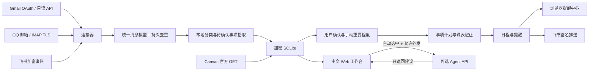

# 架构与扩展

完整说明见 [技术文档](TECHNICAL.md)，涵盖 v0.3 事项模型、重要性算法、授权、API、提醒、部署与完整交付包。本文保留模块索引和扩展约定。

## 运行结构



单实例、单管理员、每种渠道一个账号。HTTP 服务、轮询和提醒工作循环位于同一进程，禁止多 worker。数据默认存储于私有 `data/`，只有 `static/` 对浏览器公开。

## 统一消息模型

```json
{
  "id": "本地随机ID",
  "source": "gmail | qqmail | feishu",
  "external_id": "平台账号命名空间内的稳定ID",
  "title": "消息标题",
  "sender": "发件人或平台开放ID",
  "body": "安全的纯文本正文",
  "created_at": "本机接入时间，带时区",
  "read": false,
  "archived": false,
  "priority": "high | normal | low",
  "category": "工作 | 会议 | 财务 | 订阅 | 生活",
  "reason": "分类原因",
  "deadline": "可选的手动截止时间"
}
```

`created_at` 在当前版本是接入时间，并非可靠的原始发送时间。每个适配器须提供稳定 `external_id`；QQ 邮箱使用邮箱、UIDVALIDITY 与 UID，Gmail 使用邮箱与 Gmail 消息 ID。数据库唯一约束保证重复轮询不重复导入。

## 排程模型

1. 主界面筛选已确认、待办或进行中、允许加入计划且尚未关联日程的事项。
2. 将必须关注与重要映射为排程高优先级，再按截止时间排序，每轮最多 30 项。
3. 在配置时区下的未来 14 天查找空档，只考虑指定工作日与工作时间。
4. 跳过午休、课程和本地未完成日程，以 5 分钟粒度查找事项准备时长的连续时间块，并预留截止缓冲。
5. 提议保存在服务端，10 分钟后过期；提交时重新检查开始时间、事项状态、标题、时长、缓冲、重复关联与冲突。
6. 保存所有日程及提醒使用一个 SQLite 事务，任一冲突导致整批回滚。

自动排程使用相同事项规则直接保存。历史 `/api/plan` 保留基于消息的兼容排程，v0.3 界面使用 `/api/items/plan`。日程索引统一为 UTC，界面按配置时区展示。当前不猜测“明天十点”等相对表达，不自动拆分跨天任务。

## 提醒与投递

原始高优先级消息提醒默认关闭，可在个人控制台启用；事项核实后按截止配置提醒，日程提醒为开始前配置分钟数。修改全局提前量不追溯调整旧日程提醒。阅读 / 归档消息确认其消息提醒；完成 / 删除日程确认 / 移除日程提醒。完成事项还停止关联提醒并完成关联日程，飞书事项推送须逐项启用。

提醒持久存在 SQLite。免打扰时段不发出提醒，结束后补发。页面每 15 秒读取到期提醒；浏览器 Notification 是可选展示，浏览器关闭后仅保留后台飞书投递能力。

飞书投递表以 `(reminder_id, channel)` 唯一标识，记录尝试次数、退避时间和成功状态。网络响应丢失时可能重复发送；数据库去重不能替代平台侧幂等。未来可拆分为独立队列、平台幂等键和死信重试管理。

## 主要 API

所有 `/api` 真实数据读取需要 Cookie 会话。写入还需 `Origin`、`X-Relay-Request: 1` 和 `X-CSRF-Token`，登录 / 首次初始化不需已有 CSRF Token。`GET /api/session` 返回会话状态和已登录会话的 CSRF Token。

| 路径 | 用途 |
| --- | --- |
| `POST /api/setup` | 回环地址首次初始化 |
| `POST /api/login` / `POST /api/logout` | 登录 / 锁定工作区 |
| `GET /api/state` | 消息、日程、规则与脱敏连接状态 |
| `GET /api/organizer` / `PUT /api/organizer/profile` | 事项、课表、遗漏与个人控制 |
| `POST /api/items` / `PATCH /api/items/{id}` | 个人事项创建与编辑 |
| `POST /api/items/plan` | 已确认事项计划提议 |
| `POST /api/blocks` / `POST /api/blocks/import` | 课表与 CSV 导入 |
| `POST /api/connectors/canvas` | Canvas 令牌验证与配置 |
| `GET /api/services` / `PUT /api/services` | 读取脱敏配置 / 加密保存 OAuth 与 Agent 配置 |
| `POST /api/sync` | 手动同步邮箱与 Canvas |
| `PATCH /api/messages/{id}` | 已读、归档、重点、分类、截止时间 |
| `PUT /api/settings` / `PUT /api/rules` | 修改偏好 / 有序规则列表 |
| `POST /api/reclassify` | 用本地规则重新分类历史消息 |
| `POST /api/plan` | 生成保存在服务端的排程提议 |
| `POST /api/plan/{id}/commit` | 确认整批提议 |
| `POST /api/tasks` | 手动添加日程 |
| `PATCH /api/tasks/{id}` / `DELETE /api/tasks/{id}` | 完成状态 / 删除日程 |
| `GET /api/reminders` / `POST /api/reminders/{id}/ack` | 提醒中心 / 确认提醒 |
| `POST /api/connectors/gmail/authorize` | 获取 Google 官方授权 URL |
| `GET /oauth/google/callback` | 会话绑定的 OAuth 回调 |
| `POST /api/connectors/qqmail` | 验证并保存授权码 |
| `POST /api/connectors/feishu` | 保存加密事件配置 |
| `POST /webhooks/feishu` | 平台签名与加密校验后的事件入口 |
| `POST /api/push/feishu` / `DELETE /api/push/feishu` | 配置 / 删除飞书提醒推送 |
| `DELETE /api/connectors/{source}` | 删除本地渠道凭据与同步游标 |
| `POST /api/messages/{id}/analyze` | 主动分析单条消息，返回建议 |

本版 API 返回最多 1000 条最近消息。没有分页 UI、数据迁移框架和保留期自动清理；重型生产使用应先补齐这些能力。

## 扩展连接器

1. 在 `app/connectors.py` 中实现官方服务客户端，固定或由管理员配置可信目标。
2. 完成授权验证后，再把凭据写入 `Store`；不要记录令牌或用户正文到日志。
3. 通过 `ingest()` 归一化消息，把平台账号命名空间纳入 `external_id`。
4. 增量同步时先成功保存消息，再推进游标，失败时重试并依赖数据库去重。
5. 回调必须验证官方签名、时间窗口与加密内容，拒绝缺少凭据的请求；不要用通用匿名消息入口替代平台验证。
6. 在 `/api/state` 和连接中心标注可用状态；配置成功和已收到平台事件要分开显示。
7. 新增模拟服务测试，并在文档区分实现状态、平台权限和实际联调状态。

未来加入企业微信时，需要独立实现其 token、EncodingAESKey、企业标识、签名和解密流程；不能套用飞书的加密算法。QQ 机器人应使用官方应用凭据与事件协议。个人聊天的全量读取不属于这些适配器的默认授权范围。

## Agent 边界

Agent 输入是被选中的不可信消息内容，系统提示要求只返回 JSON。接口不提供模型工具、网址抓取、命令执行或自主投递权限。服务端校验分类枚举和摘要长度，前端以纯文本展示，分类变更仍由用户确认。

如需复杂任务规划，建议增加有结构 Schema 的 `TaskProposal`，返回开始时间建议、时长与来源证据；通过本地冲突检查和用户确认后才保存。不要让模型直接改数据库或持有消息渠道密钥。


## Windows 桌面宿主

`desktop.py` 先获取用户数据目录中的实例锁并保留 127.0.0.1:8765 的实际监听 socket，再启动同进程 Uvicorn，防止端口竞争时误打开另一个服务。前端通过 pywebview / WebView2 展示，不需要额外安装 Python。

关闭事件在托盘可用时取消窗口销毁并隐藏窗口；退出菜单再关闭本地服务。原生通知读取相同的持久提醒记录和免打扰偏好，不会自动确认提醒。JS bridge 只提供固定工作台浏览器入口、固定数据目录入口和通知可用状态，不接受任意 URL、文件路径或系统命令。

Google 登录转到系统浏览器，在该浏览器中重新登录本地工作区后走已有的会话绑定 OAuth 流程。不会通过 URL 携带本地会话令牌，也不会放宽回调的会话检查。

PyInstaller 资源解包目录仅用于读取代码、前端和图标。数据库、密钥与 WebView 临时 profile 位于用户数据目录。测试模式必须显式指定独立数据目录；发行物不包含任何开发测试数据库。


## v0.3 个人事项层

原始消息保持独立，新增加密 `items` 与 `busy_blocks`，任务表增补可空 `item_id` 及唯一索引。启动时迁移不重建已有表；已有消息可从界面手动回溯拾取。`organizer.py` 管理确定性抽取、可解释建议、手动覆盖、来源快照、遗漏线索、提醒身份和计划候选；`organizer_api.py` 提供受本地会话、Origin 与 CSRF 保护的操作。`canvas.py` 输出统一作业与课表数据，不执行平台写操作。

计划保存时再次验证事项确认状态、准备时长、截止缓冲与课程冲突。待确认事项不主动推送截止提醒；每项飞书推送需另行勾选，日程关联的提醒也遵循该设置。每次提醒均持久化，单项无关修改保留确认状态。

详情参见 [备忘产品与算法](ORGANIZER.md)。
