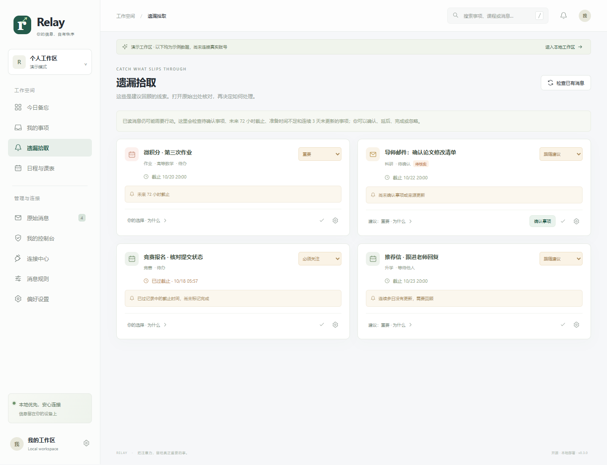
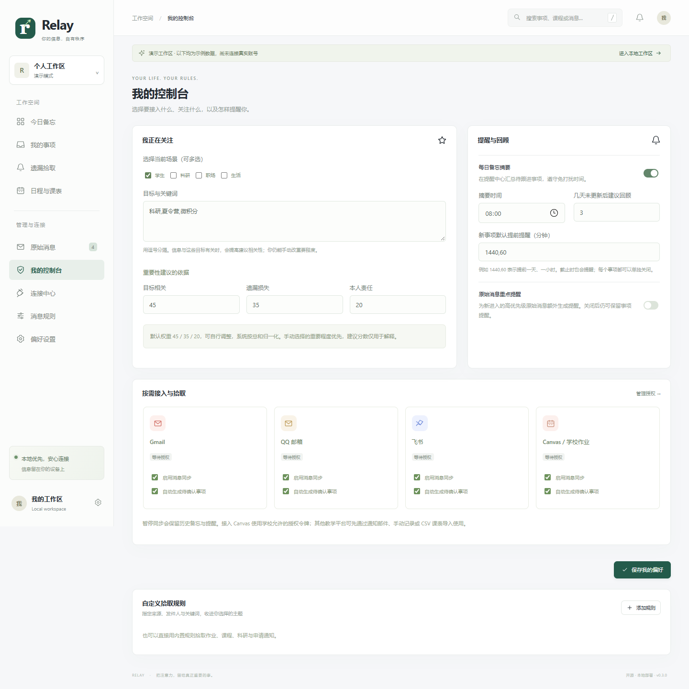

# 备忘与遗漏拾取 · v0.3

核心目标是让用户少记一些、少漏一些。学生可按课程、作业、科研、竞赛、升学分类；职场与生活场景可自选主题、目标关键词和来源。当前品牌沿用 Relay；“拾点 ShiDot”保留为候选名。

## 从线索到行动

原始消息 → 本地规则拾取 → 待确认事项 → 用户核实 → 提醒 / 个人计划 → 完成或回顾。

消息已读不表示任务已完成；原始分类与个人事项各自保存。自动拾取只抽取带明确年份、日期和时刻的唯一时间；“明晚”“周五前”、多个不同日期或只有日期时不猜截止。任何自动创建的事项均先待确认，保留识别原文和出处。用户可手动把任意消息收进事项。

同标题至少 8 字、去空白后完全一致，且明确时间相同，才跨消息合并出处；其他相似通知由用户选择合并，时间冲突重新核实。该规则偏保守，无法保证识别全部重复或全部遗漏。

Canvas 作业按学校、课程与作业 ID 去重；来源更新与用户记录分开保存。截止变化产生核对提示，不覆盖个人截止和重要程度，也不静默重开已完成事项。Canvas 已提交状态只提示本地确认。学校平台仍是实际提交状态的依据。

## 用户的控制

| 控制范围 | 可配置内容 |
| --- | --- |
| 场景与目标 | 学生、科研、职场、生活可多选；关注关键词 |
| 来源 | 按来源暂停同步、关闭自动拾取、断开授权 |
| 拾取规则 | 来源、发件人、关键词、主题与初始重要程度 |
| 每个事项 | 重要程度、状态、截止、备忘、出处、准备时长、缓冲 |
| 提醒 | 截止提醒、每日摘要、关闭；自定提前量；飞书推送单独选择 |
| 排程 | 每项允许加入计划；手动确认或全局开启自动保存 |
| 课表 | 每周重复、CSV 导入、启停占用、上课提醒开关 |

提醒不依赖模型。截止模式除所选提前量外，截止时也提醒；每日摘要每天至多一条，免打扰期间延后。已确认且非待收集状态才产生截止提醒。无关编辑不会复活已确认的旧提醒；截止与提醒配置变更会生成新的提醒标识。完成或忽略事项停止关联提醒并完成关联日程，恢复事项不自动重开旧日程；需要重新排期时先删除旧日程。完成单次工作日程只更新该时间段，不自动完成整个作业。

## 重要性与紧迫度

重要性建议采用可解释的确定性规则，三个因素都在 0–1 之间：

`I = 100 × (wR × 目标相关 + wL × 遗漏损失 + wC × 本人责任) / (wR+wL+wC)`

默认权重 45 / 35 / 20；90 以上建议“必须关注”，75 以上“重要”，45 以上“普通”，其余“低打扰”。自动因子是启发式初值，用户可编辑；该公式未经用户研究标定，不应理解为客观正确率。手动重要程度始终优先，后续来源同步和消息重新分类不会覆盖。

紧迫度单独计算。截止前可用工作分钟数扣除午休、课表和已占用时段，重叠占用按区间并集计算；再减预计准备时长与个人缓冲，得到余量 `S`。

`U = 100 × clamp(1 − S/480, 0, 1)`

过期时为 100；没有截止或超过未来 31 天暂不计算空档紧迫度。工作台排序为 `0.65 × 重要性排序值 + 0.35 × U`。自动时用 I；手动时必须关注 / 重要 / 普通 / 低打扰对应 100 / 80 / 50 / 20。算法只能根据本应用记录估计；未导入的课程、通勤和外部日历不会自动计入。它不会替用户决定真实损失或责任。

## 遗漏拾取与计划

待确认、未来 72 小时截止、逾期未完成、预计准备空档不足、多日未更新形成回顾线索。“未更新”默认 3 天，可调整；回顾线索不会擅自修改状态或每天重复单条轰炸。

排程只考虑已确认、待办 / 进行中且主动允许加入计划的事项。优先重要项，再按截止排序；在未来 14 天按五分钟步长寻找连续空档，使用事项自己的准备时长，结束时间不晚于截止减缓冲。当前不拆分跨天长任务。保存时再次检查课程冲突与事项状态，过期计划或确认后被修改的事项需重新生成。

## 本地数据与可扩展性

SQLite 的事项、来源快照、课表和规则以加密载荷保存；ID、时间和状态索引保持明文。凭据不回显、不进示例数据，不上传公开仓库。v0.2 数据库启动时增补新表与事项关联列，保留已有账号、消息与日程。升级前建议连同 `vault.key` 备份整个私有数据目录。

Gmail 使用 OAuth；QQ 邮箱使用专用授权码；飞书使用官方签名事件；Canvas 使用学校允许的个人令牌，应用仅调用 GET。个人微信 / QQ 全量聊天没有接管适配器。新教学平台可实现独立读取适配器并输出统一事项和课表模型。

Agent 当前仍为可选的单条原始消息摘要与分类建议，发送前需启用并主动点击，采纳时确认；复杂事项拆解、附件理解和自然语言课表仍待扩展。基础备忘、评分、回顾、提醒和排程均由本地代码完成。

