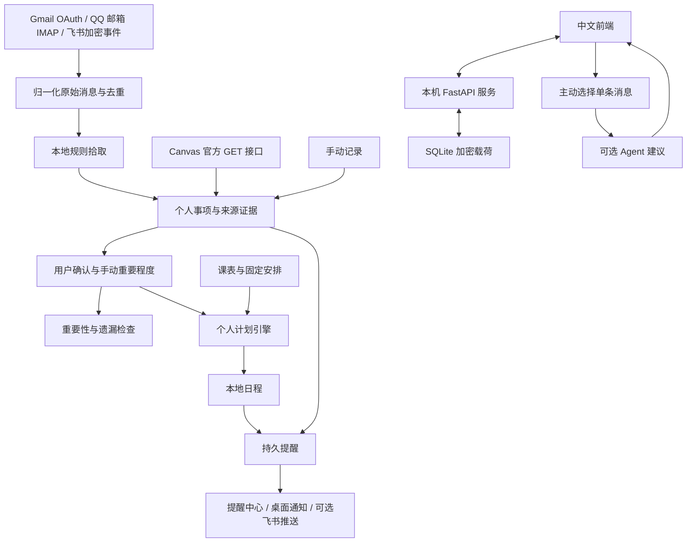

# Relay 信息中转站技术文档

适用版本：v0.3.0。文档日期：2026-10-18。本文对应已实现代码；复杂 Agent 工作流与未接入平台单列为后续扩展。

## 1. 目标与运行范围

Relay 面向个人本地部署，把邮件、工作通知和课程作业转成可核实、可跟进的备忘。流程为“收集线索 → 待确认 → 用户决定重要程度与提醒 → 计划或回顾 → 本地完成”。用户选择优先于自动建议。

当前为单实例、单管理员、每种渠道一个连接。前端、API、同步与提醒在本机运行；基础功能无需模型服务。Windows 提供单文件 exe，源码可使用 Python 或 Docker 运行。多用户隔离、多设备同步和云端常驻尚未实现。

## 2. 总体架构与代码



图中是逻辑模块，当前未拆分服务。后台使用同进程 `asyncio` 工作循环，必须保持一个 Uvicorn worker，避免独立内存会话、重复轮询和提醒竞争。

| 组件 | 技术与文件 | 职责 |
| --- | --- | --- |
| HTTP 服务 | FastAPI、Uvicorn；`app/main.py` | 工厂初始化、会话、来源与 CSRF 校验、消息接口、后台循环 |
| 事项服务 | `app/organizer.py` | 抽取、去重、来源快照、重要性、遗漏、摘要与计划候选 |
| 事项接口 | Pydantic；`app/organizer_api.py` | 事项、个人控制、课表与 Canvas 的输入验证和路由 |
| 存储 | SQLite、Fernet；`app/store.py` | 加密 JSON 载荷、索引、唯一约束与事务 |
| 规则与排程 | `app/engine.py` | 有序分类、工作时段与连续空档搜索 |
| 连接器 | HTTPX、标准库 IMAP；`app/connectors.py`、`app/canvas.py` | 平台授权、读取、事件校验和明确配置的外发 |
| 界面 | 原生 HTML / CSS / JavaScript；`static/` | 备忘、遗漏、课表、连接与偏好 |
| 桌面宿主 | pywebview / WebView2、pystray；`desktop.py` | 本机服务、独立窗口、托盘、原生通知与有限 bridge |
| 发行 | PyInstaller；`Relay.spec`、`packaging/` | exe、许可证、完整包、源码快照与校验 |

依赖版本以 `requirements*.txt` 为准。前端没有 CDN、远程字体和统计脚本；运行时不需要 Node.js。`app.js` 提供基础工作区，`organizer.js` 在其后加载个人事项交互。数据请求使用同源 Cookie 与 CSRF Token，来源内容转义为文本展示。

默认演示与真实工作区分开。解锁后读取本地真实数据，退出会话回到演示；异步响应检查工作区状态，减少切换时旧响应覆盖当前界面的风险。演示不会连接真实账号或保存真实凭据。

## 3. 数据模型与一致性

### 3.1 表与加密范围

| 表 | 明文索引或状态 | 加密载荷 / 用途 |
| --- | --- | --- |
| `kv` | `key` | 设置、密码哈希记录、规则、凭据、游标、状态、计划提议 |
| `messages` | `id, source, external_id, created_at` | 标题、发件人、正文、分类与阅读状态 |
| `items` | `id, dedupe_key, created_at, updated_at` | 个人事项、截止、重要程度、提醒和来源证据 |
| `busy_blocks` | `id, external_key, start, end` | 课程、地点、启用状态与上课提醒配置 |
| `tasks` | `id, message_id, item_id, start, end, done` | 本地个人日程载荷 |
| `reminders` | `id, task_id, due, acknowledged` | 提醒标题、类型、事项关联与渠道选择 |
| `deliveries` | `reminder_id, channel, attempts, delivered, next_try` | 飞书投递与退避状态，无正文载荷 |
| `receipts` | `id, expires` | 飞书事件短期去重 |

不是全库加密：索引保留来源、时间、ID 与部分状态。Fernet 密钥存于数据目录 `vault.key`；数据库和密钥同时泄露时无法继续保护内容。密钥丢失且数据库仍存在时，程序拒绝创建新密钥。

`Store.connect()` 用进程内可重入锁串行化连接上下文，异常回滚。消息使用 `(source,external_id)` 唯一约束；事项使用 `dedupe_key`；课程使用 `external_key`。日程对非空 `message_id` 和 `item_id` 各设唯一索引，目前一个事项只关联一个日程记录，包括已完成记录；重新排期需先删除旧日程。

### 3.2 事项结构示例

```json
{
  "title": "微积分第三次作业",
  "topic": "作业",
  "course": "高等数学",
  "source": "canvas",
  "due_at": "2026-11-01T12:00:00+00:00",
  "status": "todo",
  "verification": "confirmed",
  "importance_override": "high",
  "factors": {"relevance": 0.85, "loss": 0.75, "commitment": 0.9},
  "estimated_minutes": 60,
  "buffer_minutes": 60,
  "include_in_plan": true,
  "remind_mode": "deadline",
  "remind_offsets": [1440, 60],
  "notify_feishu": false
}
```

内部还保存 ID、时间戳、去重键、识别证据、来源列表与变更快照。重要程度为 `critical/high/normal/low`，手动字段为空时跟随建议。提醒模式为 `deadline/digest/off`，截止模式还包含截止当时的提醒。

事项状态为 `inbox/todo/doing/waiting/done/dismissed`，核实状态独立为 `needs_review/confirmed`。排程还要求待办或进行中、已核实并允许加入计划。已读消息不等于完成事项；完成工作时段不等于学校平台已提交作业。

### 3.3 来源与个人决定

消息抽取只填写包含年份和时刻的唯一明确时间。相对表达、多个不同时间或只有日期时由用户补充。跨消息自动合并仅限去空白后至少 8 字的完全相同标题及相同明确截止，来源列表保留最近 30 条。其他相似通知由用户合并，时间冲突重新核实。

Canvas 按站点、课程、作业 ID 去重。来源标题、截止与提交状态保存为 `source_snapshot`，不覆盖用户编辑字段。截止变更填写 `suggested_due_at`、记录变化并转为待核实，相关截止提醒暂缓。已提交状态只提示核对，不直接标记本地完成。

日程和提醒时间索引统一为 UTC，时间输入必须带时区，前端按配置时区展示。消息 `created_at` 是接入时间，不保证等于平台原始发送时间。

## 4. 重要性与遗漏算法

### 4.1 可解释的重要性

三个因素均为 0–1：目标相关 R、遗漏损失 L、本人责任 C。默认权重 45 / 35 / 20，可编辑并按总和归一化：

```text
I = 100 × (wR×R + wL×L + wC×C) / (wR+wL+wC)
```

分数四舍五入后，90 以上建议必须关注、75 以上重要、45 以上普通，其余低打扰。消息关键词与 Canvas 使用不同启发式初值，用户可改因素。公式未经用户研究标定，不代表真实遗漏概率或客观价值。

手动重要程度优先，用于展示和关注排序，但保留自动分数用于解释；来源同步与原始消息重新分类均不覆盖手动选择。

### 4.2 紧迫度与关注排序

在截止前累计工作日及工作时段内的可用分钟，扣除午休、启用课表和未完成日程。占用按区间并集合并，防止重叠课程重复扣减。最多计算未来 31 天。

```text
S = 截止前可用分钟 − 预计准备分钟 − 截止缓冲分钟
U = 100 × clamp(1 − S/480, 0, 1)
关注排序 = round(0.65 × 重要性排序值 + 0.35 × U)
```

过期 U 为 100，无截止或截止超过未来 31 天时暂不计算空档紧迫度。自动时重要性排序值为 I；手动必须关注 / 重要 / 普通 / 低打扰分别映射为 100 / 80 / 50 / 20。工作台关注排序与计划引擎的离散优先级排序有所区别。

### 4.3 遗漏拾取

对未完成、未忽略事项检查：未确认或来源变化待核实、未来 72 小时截止、已过截止、准备余量不足、超过配置天数未更新。未更新默认 3 天。输出回顾理由，用户决定确认、调整、完成或忽略。未导入的课程、通勤与外部日历不会计入，不能保证找出全部遗漏。

## 5. 个人计划引擎

1. 选择已确认、`todo/doing`、`include_in_plan=true` 且未关联日程的个人事项。
2. 必须关注和重要映射为排程高优先级，其余映射常规；同级按截止升序，每轮最多处理 30 项。
3. 使用每项 5–480 分钟的预计准备时长，结束不得晚于 `due_at-buffer_minutes`。
4. 在未来 14 天、工作日与工作时段内，以五分钟步长查找连续空档，避开午休、课程与未完成日程。
5. 无空档返回未安排原因，不自动拆分跨天长任务或移动已有安排。
6. 手动提议保存在服务端，10 分钟过期；提交再次检查时间、事项状态、准备时长、标题、截止缓冲、重复关联与课程冲突。
7. 日程和日程提醒整批事务保存，冲突回滚。自动排程默认关闭，开启后采用相同候选与保存检查。

历史 `POST /api/plan` 保留基于消息的排程兼容接口；v0.3 主界面和后台自动安排使用事项流程 `POST /api/items/plan`。

## 6. 后台同步与提醒

后台每约 15 秒一轮，同步周期目标为 120 秒，依次执行同步、可选排程、投递与摘要。网络请求耗时会延长实际间隔，不是硬实时调度。

事项截止提醒要求已核实，非待收集 / 完成 / 忽略状态，且选择截止模式并存在截止。提醒 ID 包含事项 ID、提前量、截止时间戳和修订号；无关编辑不复活已确认提醒，截止、状态、核实或提醒配置变化可产生新身份。

完成或忽略事项停止关联提醒并完成关联日程，恢复事项不自动重开旧日程。到期查询再次检查事项权限，关联日程提醒也遵守事项的关闭或摘要设置。原始重点消息额外提醒默认关闭；每日摘要按本地日期去重；课程可单独关闭上课提醒。免打扰期间不返回到期提醒，结束后补发。

提醒中心、浏览器通知、桌面通知与飞书推送共享持久记录。浏览器和桌面可能同时展示，展示不等于用户确认。个人事项外发飞书需逐项启用，摘要与课程默认不外发。

飞书失败最多尝试 5 次，退避为 `min(3600,30×2^已失败次数)` 秒并落盘；平台接收但响应丢失时可能重复发送，不承诺恰好一次。窗口收进托盘后继续运行，完全退出、关机或休眠时不保证提醒准时。

## 7. 授权与安全

| 渠道 | 授权与读取 | 边界 |
| --- | --- | --- |
| Gmail | OAuth 2.0、PKCE、会话绑定单次 state；`gmail.readonly` | 客户端配置与平台审核由部署者完成 |
| QQ 邮箱 | 专用授权码、固定 IMAP TLS 地址、只读选箱与 `BODY.PEEK` | 不使用 QQ 登录密码，不修改原邮件阅读状态 |
| 飞书事件 | 签名、约五分钟时间窗、加密解码、Verification Token | 仅企业应用有权限接收的文本事件 |
| Canvas | 学校个人令牌、HTTPS 根地址、仅 GET、不跟随重定向 | 应用只读取；令牌本身可能权限更广 |
| 飞书提醒 | 官方群机器人 Webhook 与签名密钥 | 向用户配置的群发送提醒标题 |

个人微信 / QQ 全量聊天、企业微信应用和 QQ 官方机器人尚无适配器。断开连接删除本地凭据，保留历史记录；平台撤权需在对应平台完成。

工作区密码使用带随机盐的 scrypt 哈希。随机会话令牌记录于服务端内存，默认 12 小时，重启重新登录；Cookie 使用 HttpOnly、SameSite=Lax，HTTPS 时启用 Secure。登录限制五分钟内的尝试次数。

真实数据要求会话；API 写入还校验精确 Origin、`X-Relay-Request: 1` 与会话 CSRF Token。首次初始化限回环访问，远程部署须先配置初始密码。请求体限制 256,000 字节，设置 Host 限制、CSP 和防嵌入响应头。外部 HTML 不直接渲染，邮件远程图片不自动加载；密钥不回显，异常不输出令牌与正文。

本机管理员、恶意程序或同时持有数据库和密钥的主体仍可能读取私有数据，这些措施不替代操作系统与设备保护。

### 7.1 Canvas 范围

每轮最多 25 门所选在读课程，每接口最多 3 页；达到上限提示缩小范围。分页只向同站点 `/api/v1/` 路径发送令牌。读取包含个人提交信息的作业，忽略未发布及超过 30 天的旧截止；新遇到已提交作业不创建事项，已跟踪作业仍更新提交快照。

可选课程日历读取未来 14 天，每请求分组最多 10 个课程上下文；忽略全天、已删除或缺少有效起止时间的事件。完整同步后暂停本地窗口内已消失事件的占用，截断时不做该清理。此能力不是完整学校课表保证，也不提供双向修改。

### 7.2 Agent 范围

用户先配置 HTTPS 服务、模型和密钥，启用外发，再主动分析单条原始消息。请求发送标题前 500 字符与正文前 6000 字符，使用兼容 Chat Completions 的 JSON 响应；服务端校验摘要和分类枚举，用户确认后才采纳。

模型没有数据库、渠道密钥、命令执行、本地工具或自主投递权限。复杂任务拆解、附件理解和自主工作流尚未实现；后续应通过结构化提议与来源证据接入，继续经过本地校验和用户确认。

## 8. API 索引

`/health`、`/api/session`、登录与初始化有独立访问规则；OAuth 回调受会话和 state 校验，飞书回调受平台签名校验。其余真实数据要求登录，API 写入还需来源与专用请求头。

| 方法与路径 | 用途 |
| --- | --- |
| `POST /api/setup`、`POST /api/login`、`POST /api/logout` | 初始化、解锁、锁定 |
| `GET /api/state`、`GET /api/organizer` | 聚合状态、事项与脱敏连接配置 |
| `GET /api/services`、`PUT /api/services` | 服务配置，密钥只返回是否存在 |
| `PUT /api/settings`、`PUT /api/organizer/profile` | 时间、目标、权重、来源策略、拾取规则 |
| `POST /api/items`、`PATCH /api/items/{id}`、`DELETE /api/items/{id}` | 事项操作 |
| `POST /api/messages/{id}/capture`、`POST /api/organizer/capture` | 单条拾取、回溯消息 |
| `POST /api/items/{id}/merge/{target_id}` | 主动合并 |
| `POST /api/items/plan`、`POST /api/plan/{id}/commit` | 个人计划提议与确认 |
| `POST /api/blocks`、`POST /api/blocks/import` | 重复课表与 CSV；先全量校验，每次最多 200 行 |
| `PATCH /api/blocks/{id}`、`DELETE /api/blocks/{id}` | 占用、上课提醒与删除 |
| `POST /api/tasks`、`PATCH /api/tasks/{id}`、`DELETE /api/tasks/{id}` | 本地日程 |
| `GET /api/reminders`、`POST /api/reminders/{id}/ack` | 到期提醒与确认 |
| `POST /api/sync` | 同步已配置来源 |
| `POST /api/connectors/gmail/authorize`、`GET /oauth/google/callback` | Gmail 授权 |
| `POST /api/connectors/qqmail`、`POST /api/connectors/feishu`、`POST /api/connectors/canvas` | 连接配置 |
| `DELETE /api/connectors/{source}` | 删除本地凭据 |
| `POST /webhooks/feishu` | 平台加密事件 |
| `POST /api/push/feishu`、`DELETE /api/push/feishu` | 提醒群配置 |
| `PATCH /api/messages/{id}`、`PUT /api/rules`、`POST /api/reclassify` | 原始消息分类 |
| `POST /api/messages/{id}/analyze` | 主动 Agent 建议 |

状态读取最多最近 1000 条消息、2000 条事项、5000 个课表占用，日程目前无分页。以上是读取上限，不是清理策略；尚无分页 UI、保留期自动清理和版本化迁移框架。

## 9. 部署、构建与备份

### 9.1 桌面与源码运行

Windows x64 解压后双击 `Relay.exe`。不需要 Python、Node.js 或 Docker；内嵌窗口依赖 Microsoft WebView2 Runtime，不可用时尝试浏览器模式。发行物未做商业代码签名。

桌面宿主先取得目录实例锁并保留实际监听 socket，避免端口竞争误连。托盘可用时关闭窗口变成隐藏，退出菜单才停止服务。bridge 仅提供固定本地工作台、数据目录入口与通知状态，不接受任意路径或系统命令。

桌面数据默认在 `%LOCALAPPDATA%\RelayStation`，不写入 PyInstaller 解包资源目录。Gmail 转到系统浏览器，重新解锁同一工作区后完成 OAuth，不在 URL 传递本地会话令牌。

源码需 Python 3.11+，安装 `requirements.txt`，运行 `python run.py`，默认 `http://localhost:8765`，仅一个 worker。主要变量为 `RELAY_ORIGIN`、`RELAY_TIMEZONE`、`RELAY_DATA_DIR`、`RELAY_ADMIN_PASSWORD`、`RELAY_SECURE_COOKIE`。源码不自动读取 `.env`，Docker Compose 会读取；Docker 默认端口仅发布至本机、数据放命名卷。远程访问需 HTTPS Origin 与相应配置。

### 9.2 构建与完整交付

```powershell
python -m venv .venv
.venv/Scripts/python.exe -m pip install -r requirements-build.txt
.venv/Scripts/python.exe packaging/collect_licenses.py
.venv/Scripts/python.exe -m PyInstaller --noconfirm Relay.spec
.venv/Scripts/python.exe packaging/package_complete.py --exe dist/Relay.exe --output release
```

最后一步要求干净的 Git 工作区。完整包包含 exe、技术文档、接入说明及图片、许可证、源码快照、构建来源和包内文件校验值；旁边生成完整包及独立技术文档的 SHA-256 文件。

若沿用已验证且运行代码未变的 exe，可用 `--runtime-commit` 指定实际构建提交。脚本检查该提交至当前提交的运行代码和打包输入未变，并分别记录运行提交与源码 / 文档提交。构建依赖与环境不同仍可能产生不同 exe 哈希，不承诺字节级可复现。

### 9.3 升级与恢复

升级前从托盘退出，再备份整个数据目录及 `vault.key`，正常退出后复制以保持数据库一致性。替换 exe 不删除私有数据；v0.2 启动时增补事项、课表表及 `tasks.item_id`，保留旧消息、凭据和日程。

恢复需要相配的数据库和原密钥，不应直接合并不同工作区。源码 `data/` 不会自动迁移到桌面目录。渠道凭据不应包含在公开源码或发行包中。

## 10. 验证与扩展

v0.3.0 已通过 42 项本地自动测试，覆盖身份、CSRF、加密、去重、模糊时间、手动覆盖、来源变化、提醒权限、课表、计划与旧库迁移。GitHub Actions 覆盖 Windows / Linux、Python 3.11 / 3.13、前端语法、Docker 启动、Windows exe 构建和移除 Python PATH 后启动。

浏览器验证过事项编辑、手动重要程度、刷新持久化、重复课程、CSV、计划提交和完成后停提醒。实际 exe 验证过窗口、表单保存、托盘、关闭窗口后后台存活和重启保留数据。平台测试使用合成数据和模拟 API，未替用户授权真实账号。

```powershell
python -m pip install -r requirements-dev.txt
python -m pytest -q
node --check static/app.js
node --check static/organizer.js
```

打包测试必须使用独立数据目录：

```powershell
dist/Relay.exe --smoke-test --data-dir C:/temp/relay-smoke-data --report C:/temp/relay-smoke.json --port 18772
dist/Relay.exe --gui-smoke --data-dir C:/temp/relay-gui-data --report C:/temp/relay-gui.json --port 18773
```

后续可增加学校平台适配器、结构化 Agent 提议、分页、任务拆分与独立队列；继续保持用户确认、手动覆盖、官方授权和来源追溯。当前限制包括启发式抽取、单段排程、无完整外部忙闲、无多用户与多设备同步。

相关说明：[产品与算法](ORGANIZER.md)、[授权接入](INTEGRATIONS.md)、[Windows 使用](WINDOWS.md)、[调研记录](RESEARCH.md)。
