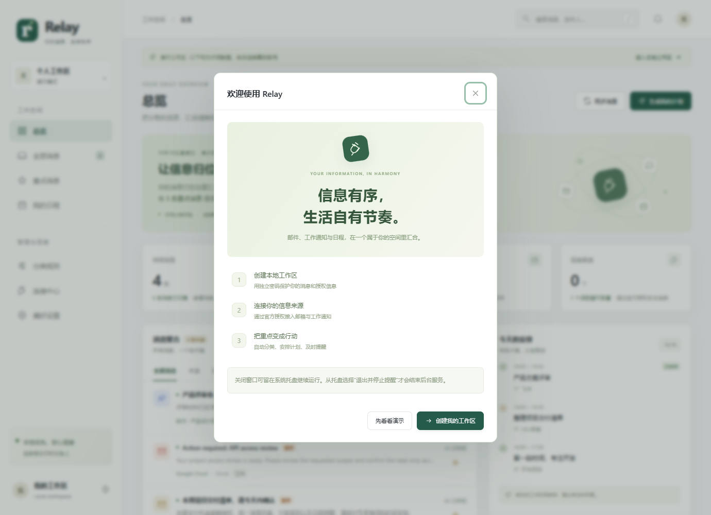

# Windows 桌面版

## 下载与打开

在 [GitHub Releases](https://github.com/ace-trump-tech/relay-station/releases) 下载 Windows x64 发行包，解压后双击 `Relay.exe`。无需安装 Python、Node.js 或 Docker，也不需要管理员权限。

完整交付包 `Relay-0.3.0-complete.zip` 还包含源码快照、技术文档、接入说明、许可证与构建来源记录。技术实现与完整包构建见 [TECHNICAL.md](TECHNICAL.md)。

桌面界面使用 Microsoft Edge WebView2 Runtime。已在本机 Windows 10 x64 上验证；Windows 10 / 11 x64 为预期支持范围。若设备缺少 WebView2 或内嵌窗口启动失败，程序会尝试使用系统浏览器，并保留一个本地启动窗口。WebView2 由 Microsoft 提供，不包含在 35 MB 左右的单文件程序内。

本发行版没有商业代码签名证书。请从本项目 Releases 下载，并使用发行包提供的 SHA-256 文件校验文件；不要关闭系统防护。

## 第一次使用

1. 双击 `Relay.exe`，点击“创建我的工作区”。也可以先查看演示。
2. 设置至少 12 位的工作区密码。它与任何邮箱 / 社交账号密码无关。
3. 打开“连接中心”，选择 QQ 邮箱或飞书，按表单填写官方提供的授权信息。
4. Gmail：先在“偏好设置 → 服务配置”填写 Google OAuth 客户端，再在系统浏览器中解锁同一工作区、完成 Google 授权。桌面窗口会在随后刷新连接状态。
5. 如需 Agent，在同一配置表单填写 HTTPS 基础地址、模型和 API 密钥；还需单独启用“允许所选消息发送给 Agent”。
6. 在偏好设置中调整工作时间，并点击“启用桌面通知”。

Google 需要由部署者创建自己的 OAuth 客户端和登记回调地址。exe 打包不会免除平台审核与用户授权步骤。连接指南见 [INTEGRATIONS.md](INTEGRATIONS.md)。



## 窗口、托盘与提醒

- 关闭主窗口后，程序收进 Windows 系统托盘，邮箱同步和提醒继续运行。
- 从托盘菜单选择“打开 Relay”恢复窗口。
- 点击“退出并停止提醒”才会结束后台服务。
- 桌面通知需在本地工作区主动启用，遵守免打扰时段。Windows 的通知设置也可能影响显示。
- 如托盘初始化失败，关闭窗口会退出；偏好设置不会声称桌面通知已可用。
- 同一数据目录只允许一个桌面实例。不要同时在 8765 端口运行源码版和桌面版。
- 不会擅自设置开机启动。退出程序、关机或设备休眠时，不保证本地消息同步和提醒准时执行。

## 数据保存在哪里

默认：`%LOCALAPPDATA%\RelayStation`，例如当前 Windows 用户的 `AppData\Local\RelayStation`。

程序与数据分开保存。移动或替换 exe 不会删除消息与授权配置。桌面顶部的“打开本地数据目录”按钮可在文件管理器中打开该目录。

消息和凭据仍使用本地加密 SQLite。备份前从托盘退出，备份整个目录，尤其是 `relay.sqlite3` 与 `vault.key`。删除目录会丢失工作区数据和密钥，普通更新不需要删除它。

桌面版不会自动读取旧源码目录下的 `data/`。如需迁移，先退出两个版本，备份旧数据，然后将旧 `data/` 内的完整内容复制到桌面数据目录；不要将两个数据库或不同密钥合并。

## 重新构建 exe

需要 Windows x64、Python 3.11+。推荐使用官方 CPython 的独立虚拟环境。

```powershell
python -m venv .venv
.venv/Scripts/python.exe -m pip install -r requirements-build.txt
.venv/Scripts/python.exe packaging/collect_licenses.py
.venv/Scripts/python.exe -m PyInstaller --noconfirm Relay.spec
```

或者运行 `build-windows.ps1`。默认输出 `dist/Relay.exe`。打包只收集代码、前端、图标与许可证，不收集 `data/`、`.env` 或用户数据目录。

自动化验证：

```powershell
dist/Relay.exe --smoke-test --data-dir C:/temp/relay-test-data --report C:/temp/relay-smoke.json
```

`--gui-smoke` 用于有交互桌面的打包 QA：会创建临时测试工作区，验证窗口、表单保存、托盘和关闭后服务存活，然后退出。必须指定独立 `--data-dir` 和 `--report`，**不要指向真实用户数据目录**。这不是正常使用的启动方式。

GitHub Actions 自动构建 Windows exe、在移除 Python PATH 后验证内嵌服务和前端资源，并提供可下载的构建产物。内嵌窗口与托盘交互另在有桌面的本机实际验证。
